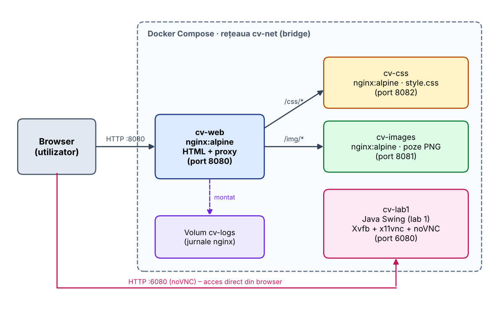

# Lab 7 – Docker, varianta 3 (dificilă)

Site CV de o pagină + propriile imagini în al doilea container + CSS în al treilea container.
În plus, lucrarea de laborator 1 (aplicația Java Swing „Timere”) rulează în al patrulea container și se deschide în browser.



| Container | Imagine | Port | Rol |
|---|---|---|---|
| `cv-web` | `cv-web:1.0` (`web/Dockerfile`) | 8080 | pagina HTML + proxy către celelalte |
| `cv-images` | `cv-images:1.0` (`images/Dockerfile`) | 8081 | pozele |
| `cv-css` | `cv-css:1.0` (`css/Dockerfile`) | 8082 | foaia de stil |
| `cv-lab1` | `cv-lab1:1.0` (`lab1/Dockerfile`) | 6080 | lab 1 (Swing) în browser, prin noVNC |

`cv-web` preia `/img/*` de la `cv-images` și `/css/*` de la `cv-css` prin rețeaua `cv-net`.

## Pornire

```bash
docker compose up -d --build
docker ps
```

Prima construire durează câteva minute (imaginea `cv-lab1` descarcă pachete).

- Site: http://localhost:8080
- Poze (direct): http://localhost:8081
- CSS (direct): http://localhost:8082/style.css
- Lab 1 (Swing, în browser): http://localhost:6080 → apasă „Connect”

## Verificare din consolă

```bash
curl -I http://localhost:8080
curl -I http://localhost:8081/profile.png        # X-Served-By: cv-images
curl -I http://localhost:8082/style.css          # X-Served-By: cv-css
curl -I http://localhost:8080/css/style.css      # CSS preluat prin cv-web de la cv-css
docker exec cv-web wget -qO- http://images/      # comunicare intre containere
docker exec cv-web wget -qO- http://css/style.css
docker logs cv-web
docker exec cv-web tail /var/log/nginx/cv_access.log   # jurnal in volumul cv-logs
docker stats --no-stream
docker network inspect lab7-cv_cv-net
docker image ls cv-web cv-images cv-css cv-lab1
```

## Fără compose (build + run)

```bash
docker network create cv-net
docker build -t cv-css:1.0 ./css
docker build -t cv-images:1.0 ./images
docker build -t cv-web:1.0 ./web
docker build -t cv-lab1:1.0 ./lab1
docker run -d --name cv-css    --network cv-net -p 8082:80 cv-css:1.0
docker run -d --name cv-images --network cv-net -p 8081:80 cv-images:1.0
docker run -d --name cv-web    --network cv-net -p 8080:80 cv-web:1.0
docker run -d --name cv-lab1   --network cv-net -p 6080:6080 --shm-size=256m cv-lab1:1.0
```

(`cv-web` se pornește după `cv-css` și `cv-images`.)

## Oprire

```bash
docker compose down        # sterge containerele si reteaua
docker compose down -v     # sterge si volumul cu jurnale
```

## Personalizare

- Poza ta: înlocuiește `images/img/profile.png` (același nume) și rulează `docker compose up -d --build`.
- Text, email, LinkedIn: `web/html/index.html`. Stil: `css/style.css`.
- Codul lab 1: `lab1/src/*.java` (neschimbat față de depozit).
